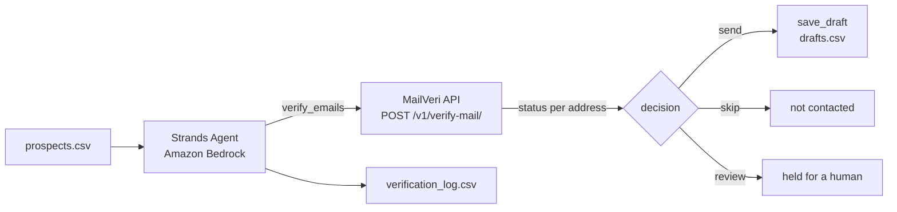

# Verified Outreach Agent with MailVeri

A Strands agent that verifies every prospect email with [MailVeri](https://mailveri.com) before it drafts outreach, so drafts only go to addresses that can receive mail and risky addresses are held for a human.

## Overview

### Sample Details

| Information            | Details                                                    |
|------------------------|------------------------------------------------------------|
| **Agent Architecture** | Single-agent                                               |
| **Native Tools**       | None                                                       |
| **Custom Tools**       | `verify_emails`, `get_credit_balance`, `save_draft`        |
| **MCP Servers**        | None (optional: [MailVeri MCP](https://github.com/mailveri/mailveri-mcp)) |
| **Use Case Vertical**  | Sales / Marketing                                          |
| **Complexity**         | Basic                                                      |
| **Model Provider**     | Amazon Bedrock                                             |
| **SDK Used**           | Strands Agents SDK                                         |

### Architecture



The agent calls `verify_emails` with the whole list, then writes a short email for each address with the decision `send`. The gate is enforced in code: `save_draft` rejects any address that was not verified in this run or whose decision is not `send`, so a prompt mistake cannot create a draft for a bad address. Nothing is sent.

| MailVeri status | Decision |
|-----------------|----------|
| `VALID` | send |
| `INVALID`, `DISPOSABLE`, `FULL_INBOX` | skip |
| `ROLE_ACCOUNT` | review (send if `SEND_ROLE_ACCOUNTS=true`) |
| `CATCH_ALL` | review (send if `SEND_CATCH_ALL=true`) |
| `UNKNOWN`, request errors | review |

### Key Features

- Class-based `@tool` methods that share state (the run's verification results) across tool calls
- A deterministic guard in a tool, not only in the system prompt
- Stops cleanly when the MailVeri account runs out of credits and reports the unchecked addresses
- CSV audit log of every status and decision

## Prerequisites

- Python **3.10+**
- [uv](https://docs.astral.sh/uv/getting-started/installation/) for dependency management
- AWS CLI configured with appropriate credentials
- [Model access](https://docs.aws.amazon.com/bedrock/latest/userguide/model-access-modify.html) enabled for Anthropic Claude Sonnet 4.6 (or set `BEDROCK_MODEL_ID` to another model)
- A MailVeri API key from [app.mailveri.com/api-keys](https://app.mailveri.com/api-keys/). Each verification uses one credit; reading the balance is free.

## Setup

1. **Configure environment variables:**
   ```bash
   cp .env.example .env
   # Edit .env and set MAILVERI_API_KEY
   ```

2. **Install dependencies:**
   ```bash
   uv sync
   ```

## Usage

**Run the sample:**
```bash
uv run verified_outreach.py
```

The example prospects use reserved `example.com` style domains, so they will not verify as `VALID`. Use your own list to see drafts:

**With your own prospects:**
```bash
uv run verified_outreach.py --prospects my_prospects.csv
```

The CSV needs an `email` column. `name`, `company` and `hook` (one line the email can open with) are optional.

**Run the tests** (HTTP is mocked, no API key or AWS access needed):
```bash
uv run --group dev pytest tests
```

## Example Queries

The script builds the prompt from the CSV. You can also use the tools in your own agent:

```python
from strands import Agent
from mailveri_tools import MailVeriTools

mailveri = MailVeriTools(api_key="your-mailveri-api-key")
agent = Agent(tools=mailveri.tools)
agent("Verify jane.doe@example.com and sales@example.org, then draft a short intro email for the ones I can send to.")
```

## Alternative: MailVeri MCP server

The same checks are available through the [MailVeri MCP server](https://github.com/mailveri/mailveri-mcp), which you can run from GitHub with `uvx`:

```python
from mcp import StdioServerParameters, stdio_client
from strands import Agent
from strands.tools.mcp import MCPClient

mailveri_mcp = MCPClient(lambda: stdio_client(StdioServerParameters(
    command="uvx",
    args=["--from", "git+https://github.com/mailveri/mailveri-mcp", "mailveri-mcp"],
    env={"MAILVERI_API_KEY": "your-mailveri-api-key"},
)))

with mailveri_mcp:
    agent = Agent(tools=mailveri_mcp.list_tools_sync())
    agent("Check my MailVeri credit balance, then verify jane.doe@example.com.")
```

The MCP route gives the model the raw tools. This sample uses custom tools instead so the send/skip/review gate is enforced in code.

## Troubleshooting

| Symptom | Likely Cause | Fix |
|---------|-------------|-----|
| `MailVeri rejected the API key` | Wrong or revoked key | Create a new key under API Keys in the MailVeri dashboard |
| `stopped: Insufficient credits` | Account has no credits left | Add credits; unchecked prospects are listed in the output |
| `MailVeri rate limit reached` | Too many requests | Wait and rerun; the tool pauses between checks |
| `AccessDeniedException` from Bedrock | Model access not enabled | Enable the model or set `BEDROCK_MODEL_ID` |

## Project Structure

| Component | File(s) | Description |
|-----------|---------|-------------|
| Agent | `verified_outreach.py` | Loads prospects, builds the agent, writes the log |
| Tools | `mailveri_tools.py` | MailVeri client, decision policy and Strands tools |
| Data | `prospects.example.csv` | Example prospect list |
| Tests | `tests/test_mailveri_tools.py` | Unit tests with mocked HTTP |

## Additional Resources

- [MailVeri API documentation](https://mailveri.com/docs/)
- [Strands Agents: Python tools](https://strandsagents.com/latest/documentation/docs/user-guide/concepts/tools/python-tools/)
- [Strands Agents: MCP tools](https://strandsagents.com/latest/documentation/docs/user-guide/concepts/tools/mcp-tools/)

## Security

- Store `MAILVERI_API_KEY` in `.env` or a secrets manager such as [AWS Secrets Manager](https://aws.amazon.com/secrets-manager/), never in source control. Error messages from the tools never include the key.
- Prospect email addresses are sent to MailVeri, a third-party service. Review the [MailVeri privacy policy](https://mailveri.com/privacy) and make sure you have a lawful basis to process and contact each prospect.
- Apply [least-privilege permissions](https://docs.aws.amazon.com/IAM/latest/UserGuide/best-practices.html#grant-least-privilege) to your AWS credentials. The sample only needs Amazon Bedrock model invocation.

## Disclaimer

This sample is provided for educational and demonstration purposes only. It is not intended for production use without further development, testing, and hardening.

For production deployments, consider:
- Implementing appropriate content filtering and safety measures
- Following security best practices for your deployment environment
- Conducting thorough testing and validation
- Reviewing and adjusting configurations for your specific requirements
